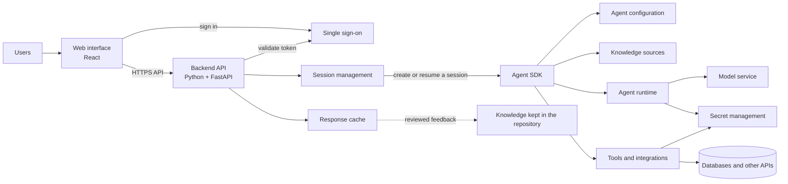

# AI Agent Platform: architecture research

A personal research project. It studies how to build an internal AI agent platform: a web application where signed-in users talk to an AI agent that can look up knowledge and query data sources.

The project has three goals:

1. **A working proof of concept (PoC)** that can serve as a reference for a later build in a company environment.
2. **Research notes with sources**, so each design choice can be traced to evidence.
3. **The owner's understanding.** The owner is a data analyst (strong in SQL, some Java and Python) and is learning architecture, backend and frontend through this project.

Nothing in this repository comes from a company. All data, names and systems are generic stand-ins.

## Target architecture

This is the design the research works toward. It is a plan, not a description of existing code.

The parts, from left to right:

- **Web interface.** What the user sees: a sign-in step, a list of conversations, a chat window.
- **Backend API.** Receives requests from the web interface, checks who the user is, and passes messages to the agent.
- **Session management.** Maps each user's conversation to an agent session, so a conversation can be resumed and users cannot see each other's data.
- **Agent SDK and runtime.** The planned choice is the GitHub Copilot SDK, which drives the Copilot CLI as its runtime. This is to be confirmed by the technical research.
- **Tools and integrations.** Functions the agent can call to query databases and other APIs.
- **Response cache and knowledge.** Reuse of earlier answers, and a loop that turns reviewed feedback into knowledge updates.

## Scope

**First PoC:** a simple frontend and backend; chat with a model through an API key; several users; several conversations per user.

**Later:** response cache, knowledge sources, connections to databases and other APIs, deployment.

**Out of scope:** anything specific to a company, and production hardening.

## How this repository is organized

- `AGENTS.md` holds the project rules and the document map. Start there.
- `CLAUDE.md` adds rules for Claude Code.
- `docs/status.md` says where the work stands now.
- `docs/tasks.md` lists milestones and tasks.
- `docs/decisions/README.md` lists every design decision and its status.
- `docs/research/` holds research reports and raw notes.

Files are in English. The owner's learning notes and the research reports written for the owner are in Chinese.
