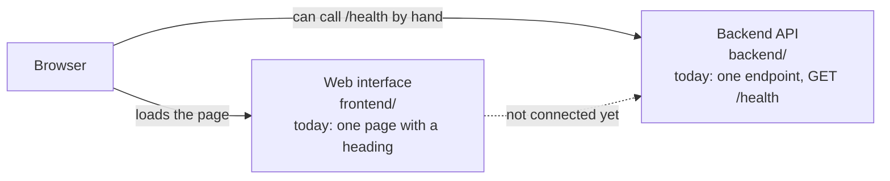
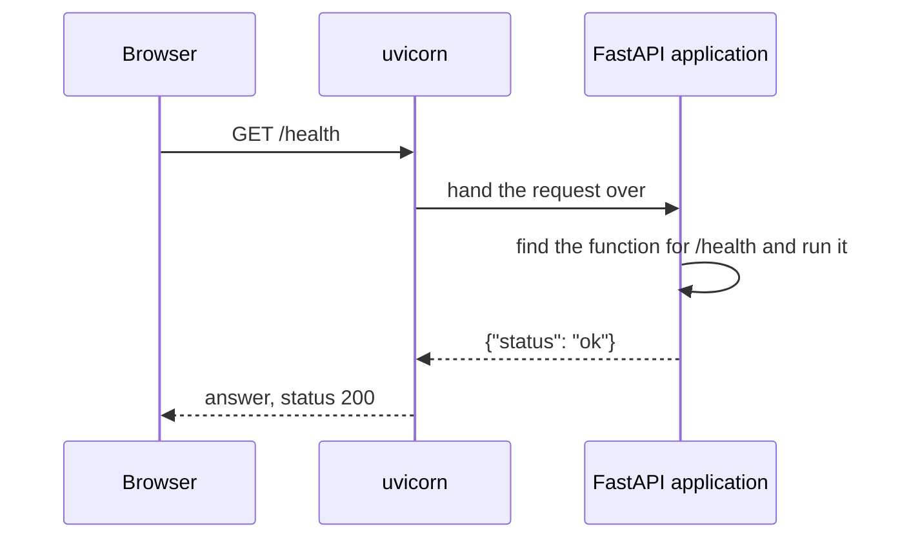
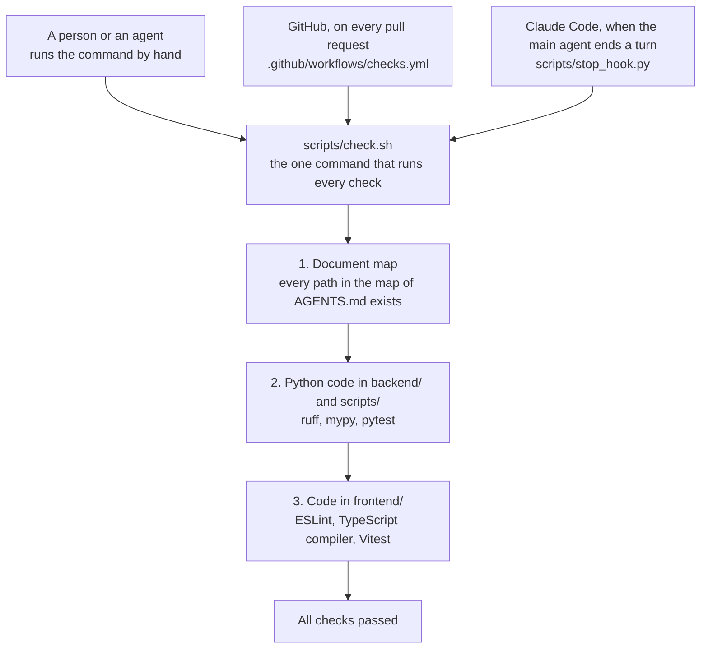

# What is built now

This file shows the parts of the system that exist today, and where the code of each part is. The target that the project works toward is in `README.md`. The plan is in `docs/tasks.md`.

Keep this file to one page. Show parts, not every file. Update it in the same change that adds, removes or moves a part.

Shows the state after task 1 of the first PoC: the skeleton and the automatic checks.

## The parts

Two parts exist, and they do not talk to each other yet. Task 7 connects them.

Not built yet: sign-in, the database, the conversations, the module that touches the agent SDK, and chat with streaming. Each is a task in `docs/tasks.md`.

## How one request travels

The only request the backend answers today is `GET /health`.

- uvicorn is the program that listens on a network port. It turns each request into a call of the application.
- The FastAPI application is `backend/app/main.py`. It holds the list of endpoints and the function behind each one.
- In the tests there is no uvicorn. The test calls the application directly.

The web interface has no request of its own yet. The browser loads `frontend/index.html`, which starts `frontend/src/main.tsx`, which draws the page in `frontend/src/App.tsx`.

## How a change gets checked

- Three callers run the same command. So a pass on one machine means the same as a pass on GitHub.
- The steps run in this order. The command stops at the first step that fails and names it.
- In steps 2 and 3, the first tool looks for careless code, the second checks the types, and the third runs the tests.

## Where the code is

| Part | Code | What it does |
|---|---|---|
| Web interface | `frontend/src/` | The page the user sees. Today it shows one heading. |
| Backend API | `backend/app/main.py` | Receives requests and answers them. Today it has one endpoint, `/health`. |
| Tests | `backend/tests/`, `frontend/src/App.test.tsx`, `scripts/tests/` | Call the code and compare the result with what is expected. |
| The check command | `scripts/check.sh` | Runs every check in order and stops at the first failure. |
| Document map check | `scripts/check_document_map.py` | Fails when a path in the document map of `AGENTS.md` is missing. |
| Stop hook | `scripts/stop_hook.py` | Runs the check command when the main agent ends a turn. `.claude/settings.json` tells Claude Code to call it. |
| Checks on GitHub | `.github/workflows/checks.yml` | Runs the check command on every pull request. |
| Installing dependencies | `scripts/setup.sh` | Installs the exact versions listed in `backend/uv.lock` and `frontend/package-lock.json`. |
| Rules of the tools | `backend/pyproject.toml`, `frontend/eslint.config.js` | Say which mistakes the tools look for. |
