# What is built now

This file shows everything that is built today in one diagram, down to the file that holds each component. The target that the project works toward is in `README.md`. The plan is in `docs/tasks.md`.

One diagram shows everything. Each box is a component, with the file that holds it. Update the diagram and the table in the same change that adds, removes or moves a component.

Rules for this file:

- Every file named in the diagram also appears in the table, with its full path from the repository root.
- Backticks are used only for paths and for addresses of the API that begin with `/`.
- An automatic check, `scripts/check_architecture.py`, verifies that each path in backticks exists.

Shows the state after task 3 of the first PoC: the skeleton, the automatic checks, the database with its users, and sign-in.

## The whole picture

```mermaid
flowchart TB
    subgraph PRODUCT["The product"]
        B["Browser"]

        subgraph FE["Web interface: frontend/"]
            HTML["index.html<br/>the empty page the browser loads"]
            MAIN["src/main.tsx<br/>starts React on that page"]
            APP["src/App.tsx<br/>the page content: one heading"]
            HTML --> MAIN --> APP
        end

        subgraph BE["Backend API: backend/"]
            UV["uvicorn<br/>listens on a network port"]
            FAST["app/main.py<br/>the FastAPI application: a list of<br/>addresses and their functions"]
            HEALTH["GET /health<br/>open: answers status ok"]
            LOGIN["app/login.py<br/>POST /login/access-token<br/>open: checks the name and password,<br/>gives a signed token"]
            PROT["app/protected.py<br/>the router whose endpoints need a token<br/>GET /users/me: the signed-in user"]
            DEPS["app/dependencies.py<br/>what an endpoint can ask for:<br/>the settings, a database connection,<br/>the signed-in user from the token"]
            CONFIG["app/config.py<br/>the settings, read from<br/>environment variables, made once"]
            DBCODE["app/database.py<br/>opens the database file<br/>and creates the two tables"]
            SCRIPT["app/create_user.py<br/>the script that creates a user"]
            USERS["app/users.py<br/>stores a new user, checks a name<br/>and password, finds a user by id"]
            SEC["app/security.py<br/>turns a password into a one-way hash,<br/>makes and reads signed tokens"]
            NB["Not built yet:<br/>conversations,<br/>agent SDK module, chat,<br/>the link to the web interface"]
            UV --> FAST --> HEALTH
            FAST --> LOGIN
            FAST --> PROT
            FAST -->|"at start: creates the tables"| DBCODE
            FAST --> CONFIG
            LOGIN --> DEPS
            PROT -->|"before each endpoint:<br/>who is signed in"| DEPS
            DEPS --> CONFIG
            DEPS --> DBCODE
            DEPS -->|"reads the token"| SEC
            DEPS -->|"finds the user"| USERS
            LOGIN -->|"checks name and password"| USERS
            LOGIN -->|"makes the token"| SEC
            SCRIPT --> CONFIG
            SCRIPT --> DBCODE
            SCRIPT --> USERS --> SEC
            FAST -.-> NB
        end

        DB[("SQLite database file<br/>tables: users, conversations")]
        ADMIN["A person, by hand"]
        DBCODE -->|"opens the file, creates the tables"| DB
        USERS -->|"writes and reads rows of users"| DB
        ADMIN -->|"runs"| SCRIPT

        B -->|"loads the page"| HTML
        B -->|"sends a request"| UV
    end

    subgraph CH["The checks"]
        P["A person or an agent<br/>by hand"]
        HOOK["Claude Code, when the main agent ends a turn<br/>scripts/stop_hook.py<br/>switched on in .claude/settings.json"]
        GH["GitHub, on every pull request<br/>.github/workflows/checks.yml"]
        CHECK["scripts/check.sh<br/>the one command that runs every check"]
        MAP["Step 1: the document map<br/>scripts/check_document_map.py<br/>every path in the map of AGENTS.md exists"]
        ARCH["Step 2: this file<br/>scripts/check_architecture.py<br/>every path in backticks in docs/architecture.md exists"]
        PY["Step 3: Python code in backend/ and scripts/<br/>ruff, mypy, pytest<br/>rules: backend/pyproject.toml<br/>tests: backend/tests/ and scripts/tests/"]
        TS["Step 4: code in frontend/<br/>ESLint, TypeScript compiler, Vitest<br/>rules: frontend/eslint.config.js<br/>tests: frontend/src/App.test.tsx"]
        P --> CHECK
        HOOK --> CHECK
        GH --> CHECK
        CHECK --> MAP --> ARCH --> PY --> TS
    end

    subgraph DEP["Installing dependencies"]
        WHO["A person, GitHub before the checks,<br/>or a new cloud session"]
        SETUP["scripts/setup.sh<br/>installs the outside packages"]
        LOCK["backend/uv.lock<br/>frontend/package-lock.json<br/>the exact version of each package"]
        WHO --> SETUP
        SETUP -->|"reads"| LOCK
    end
```

How to read it:

- An arrow means "calls" or "starts". An arrow with a label says in the label what it does. The dotted arrow points at what does not exist yet.
- The box drawn as a cylinder is a place where data lives. The database is one SQLite file on the backend's disk. By default it is the file app.db in a folder named data inside the backend folder. An environment variable, POC_DATABASE_FILE, can name another file. The file is made at run time and is not kept in the repository.
- The database has two tables: the users, and the conversations with the user who owns each one. Only the users table is filled today. Task 5 fills the conversations table.
- When the backend starts, it creates the tables if they are missing. A later start leaves the data alone.
- A person creates each user by hand with the script. The script asks for the password twice and stores only a one-way hash of it: the password cannot be read back from the database.
- How a sign-in request travels: the browser sends a user name and a password as a form to `/login/access-token`. The application finds the user in the users table and checks the password against the stored hash. For an unknown name it still checks the password against a made-up hash, so that the answer takes about as long. A right pair gets a token: a short text that holds the user id and an expiry time, signed with the secret key. A wrong password and an unknown name get the same answer, so the answer does not tell which names exist.
- How a request with a token travels: the browser sends the token in the header Authorization, after the word Bearer. Before the endpoint runs, the application checks the signature and the expiry time, reads the user id, and finds that user in the users table. If any step fails, the answer is 401, which means "sign in again", and the endpoint does not run. Today the one endpoint that needs a token is `/users/me`, which returns the id and the name of the signed-in user.
- Which endpoints are open: `/health`, `/login/access-token`, and the pages of the generated API documentation, such as `/docs`. Every other endpoint is on the router of `backend/app/protected.py`, which asks for a token before each of its endpoints. Only the methods named in that list are open: for example, `/health` is open for GET and for no other method. A test sends three requests to each method of each endpoint outside the list: one with no token, one with a made-up text in place of the token, and one with a token signed with another key. It fails if any of them is answered. The test tries the endpoints only: it does not see a request that is answered before it reaches an endpoint.
- Where the secret key comes from: from the environment variable POC_TOKEN_SECRET_KEY, which must have at least 32 characters. When it is not set, the backend makes a random key each time it starts. Then a restart of the backend signs every user out, because the old tokens were signed with the old key. A random key also fits one backend process only. With more than one process, each makes its own key, and a token from one is refused by another; then the variable must be set. A token lives for 8 days by default. The variable POC_TOKEN_EXPIRE_MINUTES changes that, to more than 0 and at most one year.
- A token cannot be withdrawn before it expires. The backend keeps no list of the tokens it gave. The only way to end every token at once is to change the secret key.
- The web interface and the backend API are the product. They do not talk to each other yet. Task 7 connects them.
- The checks are not part of the product. They look at its code: step 3 at `backend/`, step 4 at `frontend/`.
- A request to the backend goes from the browser to uvicorn, then to the application, then to the function for that address. The answer goes back the same way. In the tests there is no uvicorn: the test calls the application directly.
- Three callers run the same check command. So a pass on one machine means the same as a pass on GitHub. The steps run in order, and the command stops at the first step that fails.
- In steps 3 and 4, the first tool looks for careless code, the second checks the types, and the third runs the tests.

## Where the code is

| Component | Code | What it does |
|---|---|---|
| Web interface | `frontend/index.html`, `frontend/src/main.tsx`, `frontend/src/App.tsx` | The page the user sees. `frontend/index.html` is the empty page the browser loads. `frontend/src/main.tsx` starts React on that page. `frontend/src/App.tsx` is the page content. Today it shows one heading. |
| Backend API | `backend/app/main.py` | Receives requests and answers them. Adds the open endpoints, `/health` and the sign-in endpoint, and the router whose endpoints need a token. When it starts, it creates the database tables if they are missing. |
| Sign-in endpoint | `backend/app/login.py` | `/login/access-token`. Takes a user name and a password as a form and gives back a signed token, or answers 400. Follows the official FastAPI full-stack template; see `docs/sources.md`. |
| Endpoints that need a token | `backend/app/protected.py` | The router that asks for the signed-in user before each of its endpoints. Today it holds `/users/me`. |
| What an endpoint can ask for | `backend/app/dependencies.py` | Gives an endpoint the settings, a database connection that is closed after the request, and the signed-in user. Reads the token from the header and answers 401 when it is missing or not valid. Follows the template. |
| Settings | `backend/app/config.py` | Reads the settings from environment variables whose names begin with POC_: the path of the database file, the secret key that signs the tokens, and how long a token lives. The application makes the settings once and shares them. |
| Database | `backend/app/database.py` | Opens a connection to the SQLite file, with foreign keys switched on, and creates the two tables. The SQL is written by hand. |
| Users | `backend/app/users.py` | Stores a new user with the hash of the password. Refuses an empty name, an empty password and a name that exists. Checks a user name and a password for sign-in. Finds a user by id. |
| Passwords and tokens | `backend/app/security.py` | Turns a password into a one-way hash with Argon2, and checks a password against a hash. Makes a token signed with HS256 and reads it back. Follows the official FastAPI full-stack template; see `docs/sources.md`. |
| Script that creates a user | `backend/app/create_user.py` | Run by a person by hand from the backend folder, with the user name as its one argument. Asks for the password twice. |
| Tests | `backend/tests/`, `frontend/src/App.test.tsx`, `scripts/tests/` | Call the code and compare the result with what is expected. |
| The check command | `scripts/check.sh` | Runs every check in order and stops at the first failure. |
| Document map check | `scripts/check_document_map.py` | Fails when a path in the document map of `AGENTS.md` is missing. |
| Architecture file check | `scripts/check_architecture.py` | Fails when a path in backticks in `docs/architecture.md` is missing. |
| Stop hook | `scripts/stop_hook.py` | Runs the check command when the main agent ends a turn. `.claude/settings.json` tells Claude Code to call it. |
| Checks on GitHub | `.github/workflows/checks.yml` | Runs the check command on every pull request. |
| Installing dependencies | `scripts/setup.sh` | Installs the exact versions listed in `backend/uv.lock` and `frontend/package-lock.json`. |
| Rules of the tools | `backend/pyproject.toml`, `frontend/eslint.config.js` | Say which mistakes the tools look for. |
