# What is built now

This file shows everything that is built today in one diagram, down to the file that holds each component. The target that the project works toward is in `README.md`. The plan is in `docs/tasks.md`.

One diagram shows everything. Each box is a component, with the file that holds it. Update the diagram and the table in the same change that adds, removes or moves a component.

Rules for this file:

- Every file named in the diagram also appears in the table, with its full path from the repository root.
- Backticks are used only for paths and for addresses of the API that begin with `/`.
- An automatic check, `scripts/check_architecture.py`, verifies that each path in backticks exists.

Shows the state after task 7 of the first PoC: the skeleton, the automatic checks, the database with its users and conversations, sign-in, the module that talks to the model through the Copilot SDK, the endpoints that start a conversation, list the user's conversations and read the history of one, the endpoint that sends a message and streams the answer, the web interface that uses them through the development server of the frontend, and the browser test that runs the whole product.

## The whole picture

```mermaid
flowchart TB
    subgraph PRODUCT["The product"]
        B["Browser"]

        subgraph FE["Web interface: frontend/"]
            HTML["index.html<br/>the empty page the browser loads"]
            MAIN["src/main.tsx<br/>starts React on that page<br/>and loads src/styles.css,<br/>the styles of the whole page"]
            APP["src/App.tsx<br/>shows the sign-in page or the main view;<br/>signs out"]
            TOKEN["src/tokenStore.ts<br/>keeps the token<br/>in the storage of the tab"]
            SIGNIN["src/SignInPage.tsx<br/>the sign-in form"]
            MAINV["src/MainView.tsx<br/>the user's name, Sign out,<br/>the list and the chat;<br/>follows the address of the page"]
            ADDR["src/address.ts<br/>reads and writes the address<br/>of a conversation"]
            LIST["src/ConversationList.tsx<br/>the list of conversations,<br/>each a link to its address"]
            CHAT["src/ChatView.tsx<br/>the history, sending,<br/>the answer as it arrives,<br/>Stop, the error line"]
            MSG["src/ChatMessage.tsx<br/>one message: the user's as written,<br/>the answer as Markdown"]
            BACK["src/backend.ts<br/>the one module that calls fetch:<br/>the addresses, the token,<br/>the types and the errors"]
            STREAM["src/answerStream.ts<br/>reads the messages<br/>of the stream of an answer"]
            HTML --> MAIN --> APP
            APP --> TOKEN
            APP -->|"after sign-out:<br/>no conversation open"| ADDR
            APP --> SIGNIN
            APP --> MAINV
            MAINV --> ADDR
            MAINV --> LIST
            MAINV --> CHAT
            LIST --> ADDR
            CHAT --> MSG
            APP -->|"sign in,<br/>who is signed in"| BACK
            SIGNIN --> BACK
            MAINV -->|"list, start"| BACK
            CHAT -->|"history, send"| BACK
            BACK --> STREAM
        end

        DEV["Development server of the frontend: Vite<br/>frontend/vite.config.ts<br/>serves the page; passes each call<br/>that begins with /api on to the backend,<br/>with /api taken off"]

        subgraph BE["Backend API: backend/"]
            UV["uvicorn<br/>listens on a network port"]
            FAST["app/main.py<br/>the FastAPI application: a list of<br/>addresses and their functions"]
            HEALTH["GET /health<br/>open: answers status ok"]
            LOGIN["app/login.py<br/>POST /login/access-token<br/>open: checks the name and password,<br/>gives a signed token"]
            PROT["app/protected.py<br/>the router whose endpoints need a token<br/>GET /users/me: the signed-in user<br/>POST /conversations: start a conversation<br/>GET /conversations: the user's own, latest activity first<br/>GET /conversations/{conversation_id}/messages:<br/>the history of one conversation<br/>POST /conversations/{conversation_id}/messages:<br/>send a message, stream the answer<br/>as Server-Sent Events"]
            CONVS["app/conversations.py<br/>stores the row of a new conversation,<br/>lists a user's conversations,<br/>finds one by its id and its user,<br/>sets the time of the last activity<br/>and the title from the first message"]
            AERR["app/agent_errors.py<br/>turns an error of the agent module<br/>into 409, 503 or 500, with a fixed text;<br/>holds the text of the error message<br/>of a stream"]
            DEPS["app/dependencies.py<br/>what an endpoint can ask for:<br/>the settings, a database connection,<br/>the signed-in user from the token"]
            CONFIG["app/config.py<br/>the settings, read from<br/>environment variables, made once;<br/>among them the longest message<br/>and the length of a title"]
            DBCODE["app/database.py<br/>opens the database file<br/>and creates the two tables"]
            SCRIPT["app/create_user.py<br/>the script that creates a user"]
            USERS["app/users.py<br/>stores a new user, checks a name<br/>and password, finds a user by id"]
            SEC["app/security.py<br/>turns a password into a one-way hash,<br/>makes and reads signed tokens"]
            AGENT["app/agent.py<br/>the one module that imports the SDK:<br/>start a conversation, send a message<br/>and get the answer in pieces,<br/>read the history; one message<br/>at a time per conversation"]
            RUNTIME["Copilot SDK runtime<br/>runs inside the backend's process;<br/>downloaded by scripts/setup.sh,<br/>not kept in the repository"]
            UV --> FAST --> HEALTH
            FAST --> LOGIN
            FAST --> PROT
            FAST -->|"at start: creates the tables"| DBCODE
            FAST -->|"at start: starts the runtime<br/>at shut-down: stops it"| AGENT
            FAST --> CONFIG
            FAST -->|"adds the handlers<br/>for errors of the agent"| AERR
            LOGIN --> DEPS
            PROT -->|"before each endpoint:<br/>who is signed in"| DEPS
            PROT -->|"the error text<br/>of a stream"| AERR
            DEPS --> CONFIG
            DEPS --> DBCODE
            DEPS -->|"reads the token"| SEC
            DEPS -->|"finds the user"| USERS
            DEPS -->|"gives an endpoint the agent"| AGENT
            PROT -->|"stores and lists rows;<br/>before the agent:<br/>is it the user's own;<br/>after step one of sending:<br/>the time and the title"| CONVS
            PROT -->|"start a conversation,<br/>read the history,<br/>send a message: step one,<br/>then read or close the answer"| AGENT
            AGENT --> CONFIG
            AGENT -->|"resume, send, read events,<br/>stop, disconnect"| RUNTIME
            LOGIN -->|"checks name and password"| USERS
            LOGIN -->|"makes the token"| SEC
            SCRIPT --> CONFIG
            SCRIPT --> DBCODE
            SCRIPT --> USERS --> SEC
        end

        DB[("SQLite database file<br/>tables: users, conversations")]
        SESSIONS[("Session files of the SDK<br/>one folder per conversation:<br/>the whole history, as plain text")]
        PROVIDER["Model provider<br/>Anthropic by default"]
        RUNTIME -->|"writes and reads"| SESSIONS
        RUNTIME -->|"sends the conversation,<br/>gets the answer in pieces"| PROVIDER
        ADMIN["A person, by hand"]
        DBCODE -->|"opens the file, creates the tables"| DB
        USERS -->|"writes and reads rows of users"| DB
        CONVS -->|"writes and reads rows of conversations"| DB
        ADMIN -->|"runs"| SCRIPT

        B -->|"loads the page"| DEV
        DEV -->|"gives"| HTML
        BACK -->|"calls under /api,<br/>with the token"| DEV
        DEV -->|"passes the call on<br/>without /api"| UV
    end

    subgraph CH["The checks"]
        P["A person or an agent<br/>by hand"]
        HOOK["Claude Code, when the main agent ends a turn<br/>scripts/stop_hook.py<br/>switched on in .claude/settings.json"]
        GH["GitHub, on every pull request<br/>.github/workflows/checks.yml"]
        CHECK["scripts/check.sh<br/>the one command that runs every check"]
        MAP["Step 1: the document map<br/>scripts/check_document_map.py<br/>every path in the map of AGENTS.md exists"]
        ARCH["Step 2: this file<br/>scripts/check_architecture.py<br/>every path in backticks in docs/architecture.md exists"]
        PY["Step 3: Python code in backend/ and scripts/<br/>ruff, mypy, pytest<br/>rules: backend/pyproject.toml,<br/>with the rule that only app/agent.py imports the SDK<br/>tests: backend/tests/ and scripts/tests/,<br/>but not the browser test"]
        STANDIN["backend/tests/model_stand_in.py<br/>a local server that stands in for<br/>the model provider in the tests"]
        TS["Step 4: code in frontend/<br/>ESLint, TypeScript compiler, Vitest<br/>rules: frontend/eslint.config.js<br/>tests: frontend/src/App.test.tsx,<br/>frontend/src/backend.test.ts,<br/>frontend/src/answerStream.test.ts;<br/>with the rule that only src/backend.ts calls fetch"]
        BT["Step 5: the browser test of the whole product<br/>backend/tests/test_browser.py<br/>starts the backend under uvicorn and<br/>the development server of the frontend,<br/>and drives the page in a Chromium browser<br/>with Playwright"]
        P --> CHECK
        HOOK --> CHECK
        GH --> CHECK
        CHECK --> MAP --> ARCH --> PY --> TS --> BT
        BT -->|"the backend it starts<br/>points the runtime at it"| STANDIN
        PY -->|"the tests of app/agent.py and of<br/>the conversation endpoints<br/>point the runtime at it"| STANDIN
    end

    subgraph DEP["Installing dependencies"]
        WHO["A person, GitHub before the checks,<br/>or a new cloud session"]
        SETUP["scripts/setup.sh<br/>installs the outside packages,<br/>downloads the SDK's runtime<br/>and the browser of the browser test"]
        LOCK["backend/uv.lock<br/>frontend/package-lock.json<br/>the exact version of each package"]
        WHO --> SETUP
        SETUP -->|"reads"| LOCK
    end
```

How to read it:

- An arrow means "calls" or "starts". An arrow with a label says in the label what it does.
- The box drawn as a cylinder is a place where data lives. The database is one SQLite file on the backend's disk. By default it is the file app.db in a folder named data inside the backend folder. An environment variable, POC_DATABASE_FILE, can name another file. The file is made at run time and is not kept in the repository.
- The database has two tables: the users, and the conversations with the user who owns each one. A row of conversations holds the id, the owner, a title, the time it was made and the time of its last activity. Both times are in UTC with milliseconds. The title stays empty until the first message of the conversation. The time of the last activity is the time it was made until the first message, and then the time of the latest message.
- When the backend starts, it creates the tables if they are missing. A later start leaves the data alone.
- A person creates each user by hand with the script. The script asks for the password twice and stores only a one-way hash of it: the password cannot be read back from the database.
- How a sign-in request travels: the browser sends a user name and a password as a form to `/login/access-token`. The application finds the user in the users table and checks the password against the stored hash. For an unknown name it still checks the password against a made-up hash, so that the answer takes about as long. A right pair gets a token: a short text that holds the user id and an expiry time, signed with the secret key. A wrong password and an unknown name get the same answer, so the answer does not tell which names exist.
- How a request with a token travels: the browser sends the token in the header Authorization, after the word Bearer. Before the endpoint runs, the application checks the signature and the expiry time, reads the user id, and finds that user in the users table. If any step fails, the answer is 401, which means "sign in again", and the endpoint does not run. The endpoints that need a token are `/users/me`, which returns the id and the name of the signed-in user, and the four endpoints of conversations below.
- Which endpoints are open: `/health`, `/login/access-token`, and the pages of the generated API documentation, such as `/docs`. Every other endpoint is on the router of `backend/app/protected.py`, which asks for a token before each of its endpoints. Only the methods named in that list are open: for example, `/health` is open for GET and for no other method. A test sends three requests to each method of each endpoint outside the list: one with no token, one with a made-up text in place of the token, and one with a token signed with another key. It fails if any of them is answered. The test tries the endpoints only: it does not see a request that is answered before it reaches an endpoint.
- Where the secret key comes from: from the environment variable POC_TOKEN_SECRET_KEY, which must have at least 32 characters. When it is not set, the backend makes a random key each time it starts. Then a restart of the backend signs every user out, because the old tokens were signed with the old key. A random key also fits one backend process only. With more than one process, each makes its own key, and a token from one is refused by another; then the variable must be set. A token lives for 8 days by default. The variable POC_TOKEN_EXPIRE_MINUTES changes that, to more than 0 and at most one year.
- A token cannot be withdrawn before it expires. The backend keeps no list of the tokens it gave. The only way to end every token at once is to change the secret key.
- The second cylinder is the other place where data lives: the session files of the Copilot SDK. The whole conversation history is kept there, and nowhere else: one folder per conversation, named by the conversation id, with the messages as plain text. By default the folder is named sessions, inside the folder data of the backend folder. An environment variable, POC_SESSION_DIRECTORY, can name another folder. The files are made at run time and are not kept in the repository. The backend reads the history back through the SDK and never reads the files itself.
- `backend/app/agent.py` is the only file that imports the SDK. A rule of ruff in `backend/pyproject.toml` fails the checks when any other Python file in `backend/` or `scripts/` imports it. So the SDK can be replaced by changing one file.
- The runtime of the SDK runs inside the backend's own process. The backend starts it when it starts, and stops it when it shuts down. It is a program of about 196 MB that `scripts/setup.sh` downloads into a cache folder outside the repository.
- The model provider is outside the product. Its address, its type, the model name and the key come from environment variables: POC_MODEL_PROVIDER_ADDRESS, POC_MODEL_PROVIDER_TYPE, POC_MODEL_NAME and POC_MODEL_API_KEY. With no key, the backend still starts, and a message is refused. The system prompt of every conversation is the variable POC_SYSTEM_PROMPT, with a short default text.
- How a request to start a conversation travels: POST `/conversations`, with no body. The endpoint asks the agent module to start a conversation. The module makes the session in the session files and returns its id. The endpoint then stores a row with that id and the signed-in user in the table of conversations, and answers 201 with the new conversation. If the row cannot be stored, the session stays on disk with no row. No user can reach it, and nothing cleans it up. The endpoint writes its id to the log of the backend, at the level "error", and answers 500.
- How the list travels: GET `/conversations` reads only the table of conversations, not the agent. It gives the signed-in user's own conversations, the latest activity first. Of two with the same time of the last activity, the one that was made later comes first.
- How a request for the history travels: GET `/conversations/{conversation_id}/messages`. The endpoint first looks in the table of conversations for a row with this id and the signed-in user, in one query. When there is none, it answers 404 with "Conversation not found", and the agent module is not called. The answer is the same when the conversation belongs to another user, when no conversation has this id, and when the id has another form than the ids the module makes. So the answer does not tell whether a conversation exists. When the row is found, the endpoint asks the agent module for the history and answers with the messages in order, each with its role, "user" or "assistant", and its text.
- The answers of the list and of the history are objects with one list inside, so that a field can be added later without breaking a frontend.
- How a message travels through the endpoint: POST `/conversations/{conversation_id}/messages`, with a JSON body that holds one field, the text. The steps run in this order, and a refusal in any of them is an ordinary JSON answer with a status code, never a stream:
  1. The token is checked, as for every endpoint on the router: 401.
  2. The body is checked: 422 when the text is missing or not a string, empty, only white space, or longer than the setting for the longest message. Every 422 has the shape that FastAPI gives a body that fails validation: a list under "detail", each entry with the field, the problem and a type. The answer for a text that is too long names the limit, in its sentence and as a number, and does not repeat the text. This check comes before the next one, so a bad body gets 422 whatever the conversation id is.
  3. The endpoint looks for the row with this id and the signed-in user, as the history does. When there is none, it answers the same 404 as the history, and the agent module is not called.
  4. Step one of the agent module, below. A conversation that is still answering gets 409, a backend with no model key gets 503, and any other error of the module gets 500.
  5. The endpoint writes the row of the conversation once: the time of the last activity becomes now, and when the row has no title, the title is made from the text of the message. Every run of white space, line breaks too, becomes one space, white space at both ends is removed, and the first characters are kept, as many as the setting says. Nothing marks a cut. This comes after step one, so a message that step one refuses changes nothing. If this write fails, the answer of step one is closed at once, so the conversation is not left busy, and the browser gets the plain-text 500 of the framework.
  6. The stream starts, with status 200, and the endpoint passes on each piece of the answer as the agent module gives it.
- The steps that can refuse a message run in a dependency of the endpoint, in `backend/app/protected.py`, because a dependency runs before the status 200 goes out. The code of the endpoint itself runs only after it. The same dependency closes the answer after the stream has ended, also when the reader has gone away.
- The format of the stream: Server-Sent Events. Each message is one line that begins with "data:" and holds one JSON object, followed by an empty line. The field "type" of the object gives the kind of message. A "text" message holds one piece of the answer's text. An "end" message says that the answer is complete. An "error" message says that the answer could not be completed, and holds a fixed, general text. A stream ends with exactly one "end" or one "error", and nothing follows it. A stream that closes with neither was cut off. A line that begins with a colon is a comment that FastAPI sends when the stream has been quiet for 15 seconds; a reader skips it. The "event:" line of Server-Sent Events is not used. The generated API documentation at `/docs` describes the three kinds of message and every error answer, so that any frontend can be written against it.
- When the agent module fails while the answer streams, the status code has gone out already. The stream then ends with an "error" message. Only an error of the agent module becomes an error message. Its text, its type and the status code from the provider go to the log of the backend, at the level "error", and never to the stream.
- The endpoint does not write to the database while the answer streams, because it runs on the event loop, and a slow database call there would hold every open stream.
- Which status code an error of the agent module gets: the endpoints let the error rise, and `backend/app/agent_errors.py` turns it into an answer. A conversation that is still answering gets 409. A backend with no model key gets 503, with a text of its own that says so. Every other error of the module gets 500, for example a row whose session files are gone, or a runtime that failed. The answers are JSON with a fixed text. The text of the error itself goes to the log of the backend and never to the browser. The same file holds the fixed text of the error message of a stream.
- The three endpoints that call the agent module, start, history and sending, run on the event loop of the backend, because the actions of the module are async. Their calls to the database then block the loop for a moment. This is accepted for the first PoC, because the calls are short and the database is a local file. The list does not call the module and runs in a worker thread, like every plain endpoint.
- Two settings belong to sending: POC_LONGEST_MESSAGE_CHARACTERS, the longest message in characters, 20,000 by default, and POC_TITLE_CHARACTERS, how many characters a title keeps, 50 by default. Both must be more than 0.
- How a message travels through the agent module, called by the endpoint above:
  1. Step one: the module checks the conversation id, checks that a model key is set, and checks that the conversation is not answering already. If any check fails, it refuses the message with an error, and nothing reaches the model. Otherwise it marks the conversation as answering.
  2. Step two: the module resumes the conversation's session from its files, with the project's system prompt, no tools, and the provider settings. It sends the message. The runtime sends the whole conversation to the model provider and gets the answer back in pieces. The module passes on each piece of text as it arrives.
  3. When the answer ends, the module disconnects the session, so no session stays open in memory, and marks the conversation free. The runtime has written the message and the answer to the session files.
  4. If the reader stops early, the module tells the runtime to stop the model, then disconnects. If the provider answers with an error, or sends nothing for longer than POC_ANSWER_WAIT_SECONDS (120 seconds by default), the reader gets an error, and the module stops and disconnects the same way. In every case the conversation takes a new message afterwards.
- The module keeps in memory which conversations are answering. This fits one backend process only. Reading the history of a conversation that is answering waits until the answer has ended.
- The web interface and the backend API are the product.
- How the page reaches the backend: the page calls its own address, on paths that begin with /api. In development, the development server of the frontend, Vite, serves the page and passes each such call on to the backend, with /api taken off: a call to /api/conversations reaches the backend as `/conversations`. So the browser calls only the address of the page, and the backend needs no setting that allows another address. The address of the backend comes from the environment variable POC_BACKEND_ADDRESS, and is http://127.0.0.1:8000 by default, the address that uvicorn uses when given none. The prefix is written in two places that name each other: the proxy rule in `frontend/vite.config.ts` and a constant in `frontend/src/backend.ts`. This is for development only; a deployment needs another part that passes the calls on. The proxy passes the stream of an answer on piece by piece, and closes its connection to the backend when the browser closes its own.
- `frontend/src/backend.ts` is the only file of the frontend that calls fetch. A rule in `frontend/eslint.config.js` fails the checks when any other file in the folder src of the frontend names it. The module knows the addresses, sends the token, and turns each answer into the project's own types and errors, so a component never reads a status code: a 401 becomes "sign in again"; another failure becomes an error with a text for the user, the text of the backend when it has one, and so does a success answer whose body cannot be read; no answer at all becomes "the backend cannot be reached". The types of the answers are written by hand from the models of the backend.
- Where the token is kept: in the storage of the tab, which a browser calls sessionStorage. It stays after a reload and is gone when the tab is closed, so two tabs can hold two users. Only `frontend/src/tokenStore.ts` touches it. "Sign out" makes the browser forget the token and makes no call: the backend has no sign-out. A 401 on any call does the same. When the page loads with a token, it reads the signed-in user; a 401 then removes the token, and any other failure only says that the backend cannot be reached.
- The address of a conversation: #/conversations/ followed by the conversation id. The part after # never goes to a server; only the page reads it. Any other form opens no conversation. The page follows the change of the address, so the back and forward buttons work, and a reload opens the same conversation. Only `frontend/src/address.ts` reads and writes it. Each conversation in the list is a link to its address.
- The list of conversations keeps the order of the backend, the latest activity first. The page reads it when the main view opens, after it starts a conversation, and when the stream of an answer starts: the backend has written the title and the time by then, so the conversation moves to the top.
- How the page reads the stream of an answer: `frontend/src/answerStream.ts` takes the body of the response as byte chunks and gives the messages one by one. It ends a message at an empty line, reads the JSON of the "data:" line, skips a comment line, and skips a kind of message it does not know, so a later backend can add kinds. A chunk may end anywhere, even inside a character of several bytes. A "data:" line that is not JSON, or a known kind that lacks its field, is an error of the reader. The file makes no network call, so its tests feed it chunks directly. The chat view tells four endings apart:
  1. An "end" message: the answer stays as it is. A new message can be sent when the stream has closed.
  2. An "error" message: the error line shows its text, and the page reads the history again.
  3. A stream that closes with neither, or whose connection breaks while it is read: the error line says that the connection was lost before the answer ended, and the page reads the history again.
  4. "Stop" by the user: the page closes the connection, and the backend then stops the model. A line says that the answer was stopped, and the page reads the history again, which then holds the user's message with no answer.
  Opening another conversation, signing out, and closing or reloading the page also close the connection. A message that the backend refuses before the stream is taken off the chat, and its text goes back into the box. A stream that breaks its format shows the error of the reader in the error line, and the page reads the history again. When the history cannot be read again, the sent message and the part of the answer are taken off the chat, so nothing that may not be stored stays on it; the error line shows why, and the user reloads the page to go on.
- The answer is drawn as Markdown by the library react-markdown, with its default settings. It does not run or draw HTML that an answer holds. The user's own message is shown as written, not as Markdown.
- The checks are not part of the product. They look at its code: step 3 at `backend/`, step 4 at `frontend/`, and step 5 at the two together.
- The browser test, `backend/tests/test_browser.py`, runs the whole product as a user does. In one pytest process it starts the stand-in for the model provider, the real backend under uvicorn as a child process, the development server of the frontend as another child process, and a headless Chromium browser through Playwright. The backend gets the environment that the fixtures of `backend/tests/conftest.py` set: a database file and a folder of session files of its own, the address of the stand-in, and a model key made at run time, so no real model is called. Two users are stored with passwords made at run time. User A signs in, starts a conversation, and sends two messages. The stand-in holds the first answer before its first piece, so the page shows that the model is working, and holds the second after two pieces, so the test sees those pieces and none of the rest, and the Stop button; then the test lets it go on. The test sees the title in the list, reloads the page and sees the history, signs out, signs in as user B, sees an empty list, and opens A's conversation by its address to see "Conversation not found". It also checks that every request to the stand-in carried the key of the test. When it ends, it stops the browser and both servers. When it fails, it prints the text of the page, its console, and what the two servers wrote.
- The browser test is marked "browser". The plain pytest of step 3 leaves it out, through addopts in `backend/pyproject.toml`, and step 5 runs it and nothing else. It lives in the backend folder because it runs in one process with the stand-in and uses the fixtures of the backend tests.
- A request to the backend goes from the page, through `frontend/src/backend.ts`, to the development server of the frontend, then to uvicorn, then to the application, then to the function for that address. The answer goes back the same way. In the tests of the backend there is no uvicorn: the test calls the application directly. The tests of the frontend replace fetch, so no request leaves them.
- Three callers run the same check command. So a pass on one machine means the same as a pass on GitHub. The steps run in order, and the command stops at the first step that fails.
- In steps 3 and 4, the first tool looks for careless code, the second checks the types, and the third runs the tests. Step 5 is checked by ruff and mypy in step 3, like every Python file.

## Where the code is

| Component | Code | What it does |
|---|---|---|
| Web interface | `frontend/index.html`, `frontend/src/main.tsx`, `frontend/src/styles.css`, `frontend/src/App.tsx` | The page the user sees. `frontend/index.html` is the empty page the browser loads. `frontend/src/main.tsx` starts React on that page and loads `frontend/src/styles.css`, the plain CSS of the whole page. `frontend/src/App.tsx` shows the sign-in page when the browser holds no token, and the main view of the signed-in user otherwise; it also signs out. |
| Sign-in page | `frontend/src/SignInPage.tsx` | The form with a user name and a password. Shows the text of the backend's answer for a wrong pair. |
| Main view | `frontend/src/MainView.tsx` | The name of the signed-in user, "Sign out", the list of conversations on the left and the chat on the right. Follows the address of the page, reads the list, and starts a new conversation. |
| List of conversations | `frontend/src/ConversationList.tsx` | The conversations in the order of the backend, each a link to its address, with "New conversation" for one with no title. Marks the open one. |
| Chat view | `frontend/src/ChatView.tsx` | Reads and shows the history. Sends a message, shows the answer as it arrives, shows that the model is working, has "Stop", and shows the error line. Tells the four endings of a stream apart. |
| One message | `frontend/src/ChatMessage.tsx` | Shows the user's text as written, and the assistant's text as Markdown with react-markdown. |
| Module that talks to the backend | `frontend/src/backend.ts` | The only file of the frontend that calls fetch. The six calls of the backend: sign in, the signed-in user, list, start, history, send. Sends the token, and turns answers into the project's own types and errors. |
| Reader of the stream | `frontend/src/answerStream.ts` | Turns the byte chunks of the stream of an answer into its messages. Makes no network call. |
| Token | `frontend/src/tokenStore.ts` | The one place that reads, writes and removes the token in the storage of the tab. |
| Address of the page | `frontend/src/address.ts` | The one place that reads and writes the address of a conversation, and follows its changes. |
| Development server | `frontend/vite.config.ts` | The settings of Vite. Its proxy rule passes each call that begins with /api on to the backend, with the prefix taken off. The address of the backend is the environment variable POC_BACKEND_ADDRESS. Also holds the settings of the frontend tests. |
| Backend API | `backend/app/main.py` | Receives requests and answers them. Adds the open endpoints, `/health` and the sign-in endpoint, and the router whose endpoints need a token. Adds the handlers for errors of the agent module. When it starts, it creates the database tables if they are missing, and makes the one agent object and starts the SDK's runtime. When it shuts down, it stops the runtime. |
| Sign-in endpoint | `backend/app/login.py` | `/login/access-token`. Takes a user name and a password as a form and gives back a signed token, or answers 400. Follows the official FastAPI full-stack template; see `docs/sources.md`. |
| Endpoints that need a token | `backend/app/protected.py` | The router that asks for the signed-in user before each of its endpoints. It holds `/users/me`, and four endpoints of conversations: POST `/conversations` starts one, GET `/conversations` lists the user's own, GET `/conversations/{conversation_id}/messages` reads the history of one after checking that it is the user's own, and POST on the same address sends a message and streams the answer as Server-Sent Events. It also defines the request body of a message and the three kinds of message of the stream, with the descriptions that the generated API documentation shows. |
| Conversations | `backend/app/conversations.py` | Stores the row of a new conversation for a user. Lists a user's conversations, the latest activity first. Finds one conversation by its id and its user in one query, and finds nothing for a conversation of another user. Makes a title from the text of a message, and sets the time of the last activity and the title of a row that has none. The SQL is written by hand. |
| Answers for errors of the agent | `backend/app/agent_errors.py` | Turns an error of the agent module that an endpoint lets rise into an answer: 409 for a conversation that is still answering, 503 when no model key is set, 500 for every other error. The answer has a fixed text; the text of the error goes to the log. Also holds the fixed text of the error message of a stream. `backend/app/main.py` adds these handlers to the application. |
| What an endpoint can ask for | `backend/app/dependencies.py` | Gives an endpoint the settings, a database connection that is closed after the request, the signed-in user, and the agent object. Reads the token from the header and answers 401 when it is missing or not valid. Follows the template. |
| Settings | `backend/app/config.py` | Reads the settings from environment variables whose names begin with POC_: the path of the database file, the secret key that signs the tokens, how long a token lives, the model key, the model name, the provider type and address, the folder of the session files, the system prompt, the longest wait for the next part of an answer, the longest message a user may send, and how many characters a title keeps. The application makes the settings once and shares them. |
| Database | `backend/app/database.py` | Opens a connection to the SQLite file, with foreign keys switched on, and creates the two tables. The SQL is written by hand. A database file made before task 5 lacks the column of the last activity and must be deleted by hand. |
| Users | `backend/app/users.py` | Stores a new user with the hash of the password. Refuses an empty name, an empty password and a name that exists. Checks a user name and a password for sign-in. Finds a user by id. |
| Passwords and tokens | `backend/app/security.py` | Turns a password into a one-way hash with Argon2, and checks a password against a hash. Makes a token signed with HS256 and reads it back. Follows the official FastAPI full-stack template; see `docs/sources.md`. |
| Agent module | `backend/app/agent.py` | The only file that imports the Copilot SDK. Starts and stops the SDK's runtime inside the backend's process, in the mode "empty", with the session files in the folder from the settings. Gives the rest of the backend three actions: start a conversation, send a message and get the answer in pieces, and read the history. Lets one message at a time into a conversation. Stops the model when the reader of an answer goes away. Refuses an id it did not make. No type of the SDK leaves the module. |
| Script that creates a user | `backend/app/create_user.py` | Run by a person by hand from the backend folder, with the user name as its one argument. Asks for the password twice. |
| Tests | `backend/tests/`, `frontend/src/App.test.tsx`, `frontend/src/backend.test.ts`, `frontend/src/answerStream.test.ts`, `scripts/tests/` | Call the code and compare the result with what is expected. |
| Browser test | `backend/tests/test_browser.py` | Starts the backend and the development server of the frontend as child processes, with the stand-in for the model provider, and drives the page in a headless Chromium browser with Playwright: two users, sign-in, a conversation, an answer that arrives in pieces, a reload, sign-out, and a conversation of another user. Stops every process it started. Marked "browser", so only the last step of the check command runs it. |
| Stand-in for the model provider | `backend/tests/model_stand_in.py` | Used by the tests only. A small server on 127.0.0.1 that speaks the streaming format of the Anthropic Messages API and records the requests it gets. A test tells it how to answer: in pieces, held open until the test lets it go on, with an error status, or not at all. So the tests need no model key and call no real model. |
| The check command | `scripts/check.sh` | Runs every check in order and stops at the first failure. Its last step runs the browser test, with pytest from the backend folder. |
| Document map check | `scripts/check_document_map.py` | Fails when a path in the document map of `AGENTS.md` is missing. |
| Architecture file check | `scripts/check_architecture.py` | Fails when a path in backticks in `docs/architecture.md` is missing. |
| Stop hook | `scripts/stop_hook.py` | Runs the check command when the main agent ends a turn. `.claude/settings.json` tells Claude Code to call it. |
| Checks on GitHub | `.github/workflows/checks.yml` | Runs the check command on every pull request. Before that, installs the system libraries that the browser of the browser test needs. |
| Installing dependencies | `scripts/setup.sh` | Installs the exact versions listed in `backend/uv.lock` and `frontend/package-lock.json`. Then downloads the runtime of the Copilot SDK, in the version that the pinned SDK names, into a cache folder outside the repository. Then installs the Chromium of Playwright for the browser test, unless the variable PLAYWRIGHT_SKIP_BROWSER_DOWNLOAD says that the machine brings its own browser. A failed download gives a warning and does not stop the script. |
| Rules of the tools | `backend/pyproject.toml`, `frontend/eslint.config.js` | Say which mistakes the tools look for. `backend/pyproject.toml` also holds the rule that only `backend/app/agent.py` may import the Copilot SDK. `frontend/eslint.config.js` also holds the rule that only `frontend/src/backend.ts` may call fetch. |
